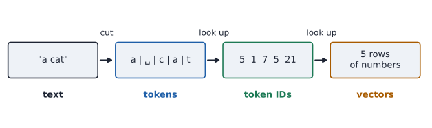

A language model never sees text the way you do. It sees numbers. This week you follow text on its way in: cut into **tokens**, numbered with **token IDs**, and turned into **vectors** (embeddings).



## Learning goals

By the end of the week you can:

1. **Explain** what a token is, and the trade-off between words, characters and subwords
2. **Build** a small tokenizer that encodes text to IDs and decodes it back exactly
3. **Describe** byte-pair encoding (BPE) in plain words: count neighbouring pairs, merge the most common, repeat
4. **Turn** token IDs into vectors with an embedding table, and say why an ID is a label, not an amount
5. **Judge** a practical consequence: why tokenization affects spelling questions, numbers, cost and other languages

## Do this, in order (about 2.5 hours)

| Step | What | Time |
|---|---|---|
| 1 | [Watch the lecture](#lecture), or read the slides at your own pace | 45 min |
| 2 | **Main exercise:** the [notebook](notebook.ipynb), five blanks with automatic checks and a self-check at the end | 60 min |
| 3 | Exercise 1B: the BPE merge loop (its own notebook, added soon) | 30 min |

(lecture)=
## Lecture

The video will appear here. The slides are the same lecture: click in the slides and use the arrow keys, or press **F** for full screen.

```{iframe} /llm/slides/week-1/
:width: 100%
:title: Week 1 slides
```

[Open the slides in their own tab](https://courses.brianjalaian.com/llm/slides/week-1/)

## Prerequisites

Basic Python: lists, dictionaries, loops and functions. No machine learning or PyTorch background. Everything runs on a free CPU notebook, with no GPU and no required downloads.

## Words to know

| Term | Plain meaning |
|---|---|
| **Token** | one piece of text: a word, part of a word, a character, or a byte |
| **Vocabulary** | the list of all pieces a tokenizer knows |
| **Token ID** | a piece's number in the vocabulary. A label, not an amount |
| **Encode / decode** | text → IDs / IDs → text |
| **BPE** | byte-pair encoding: a way to *learn* the pieces by gluing the most common neighbours together, again and again |
| **Merge** | one round of BPE: two neighbours become one new piece |
| **Byte** | the unit computers store text in. There are 256 different ones, enough to write any text |
| **Embedding** | the row of numbers that stands for a token. Starts random, adjusted during training |

## Going further (optional)

- A. Karpathy, *Let's build the GPT Tokenizer*: [video](https://www.youtube.com/watch?v=zduSFxRajkE) (long and excellent)
- S. Raschka, *Build an LLM from Scratch 2: Working with text data*: [video](https://www.youtube.com/watch?v=341Rb8fJxY0)
- S. Raschka (2025), [*Implementing A Byte Pair Encoding (BPE) Tokenizer From Scratch*](https://sebastianraschka.com/blog/2025/bpe-from-scratch.html). This and the Karpathy video contain full answers to Exercise 1B, so try that first
- J. Alammar (2019), [*The Illustrated Word2vec*](https://jalammar.github.io/illustrated-word2vec/): embeddings in pictures

## References and credits

- Sennrich, R., Haddow, B., & Birch, A. (2016). Neural machine translation of rare words with subword units. *ACL 2016*, 1715–1725. [doi:10.18653/v1/P16-1162](https://doi.org/10.18653/v1/P16-1162)
- Gage, P. (1994). A new algorithm for data compression. *The C Users Journal*, 12(2), 23–38.
- Radford, A., Wu, J., Child, R., Luan, D., Amodei, D., & Sutskever, I. (2019). Language models are unsupervised multitask learners. OpenAI.
- Petrov, A., La Malfa, E., Torr, P. H. S., & Bibi, A. (2023). Language model tokenizers introduce unfairness between languages. *NeurIPS 2023*. [arXiv:2305.15425](https://arxiv.org/abs/2305.15425)
- Course order inspired by Raschka, S. (2024). *Build a Large Language Model (From Scratch)*. Manning, Chapter 2 ([code](https://github.com/rasbt/LLMs-from-scratch): Apache 2.0, excluding the book and its images), and Karpathy's tokenizer lecture ([minbpe](https://github.com/karpathy/minbpe): MIT). All text, code and drawings on this page were made for this course.
- GPT-2 tokenizations computed with [tiktoken](https://github.com/openai/tiktoken) (MIT).
